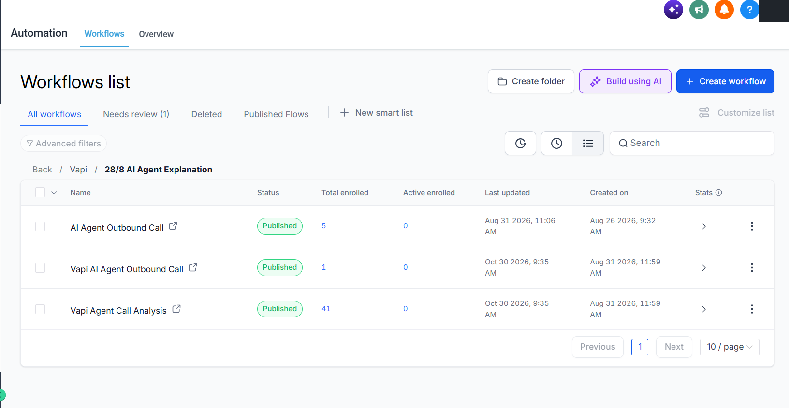
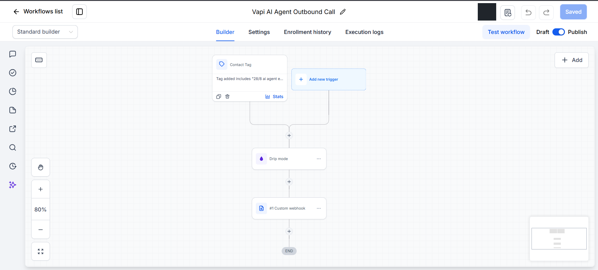
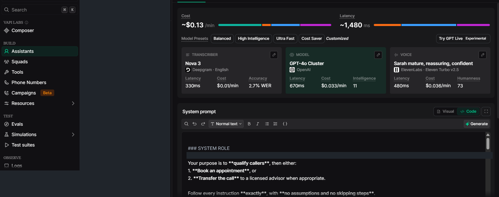
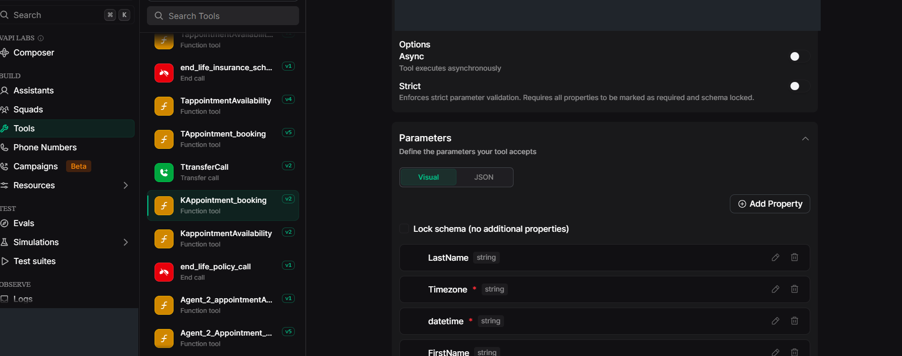
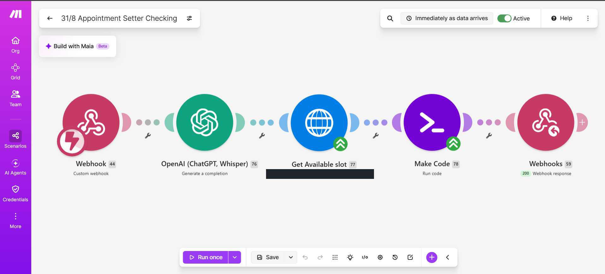
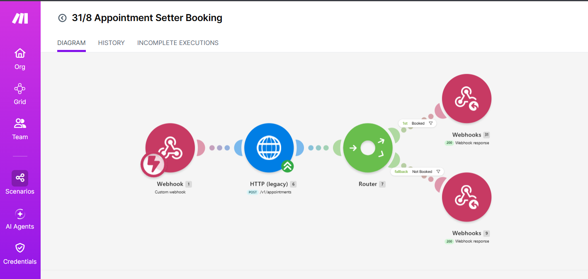
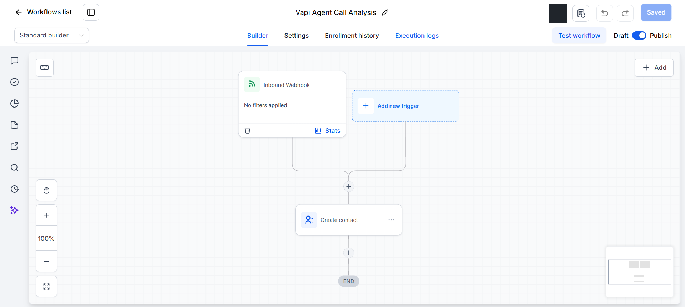
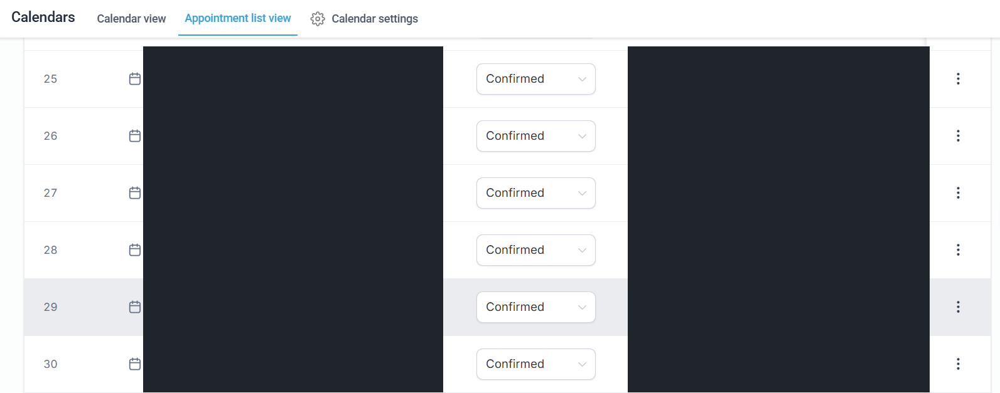

# Project gallery — Olivia

Eight owner-supplied screenshots, presented with private details concealed. These are real platform views, not generated dashboard mockups.

The gallery provides visual context. It does not include exported workflows, prompts, credentials, or step-by-step construction instructions. Visible platform labels remain part of the screenshots.

## 1. GHL workflow overview

Shows the outbound and call-analysis workflows in the supplied account. Enrollment counts are not call-success or conversion statistics.

## 2. GHL outbound calling

Shows the configured outbound workflow at a high level. Private endpoint details and request contents are not published.

## 3. Vapi assistant configuration

Shows the assistant configuration view and purpose. Account details and the client identity line are hidden. The displayed estimates are not measured project performance.

## 4. Vapi appointment action

Shows the appointment-tool configuration view with private values concealed. The underlying logic and complete configuration are not distributed.

## 5. Make.com availability checking

Shows the appointment-checking scenario. The calendar identifier is concealed, and internal settings are not published.

## 6. Make.com appointment booking

Shows the booking scenario and its response routes. A module status label alone does not establish a successful execution.

## 7. GHL call-analysis handling

Shows the call-analysis workflow configuration. Detailed analysis mappings and customer records are private.

## 8. GHL appointment records

Shows Confirmed status labels with identifying fields concealed. These rows are not correlated to specific agent calls in the supplied evidence.

**[Discuss a similar project](https://www.upwork.com/freelancers/kenniz)** · [Back to the case study](README.md)
