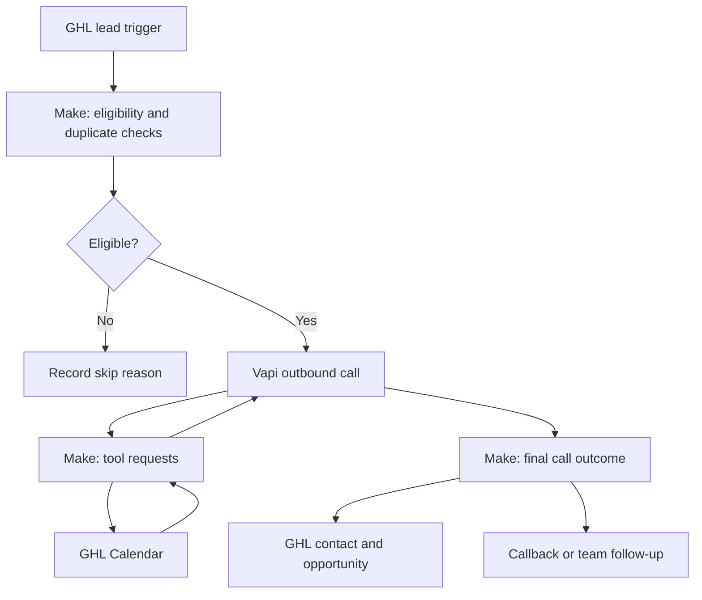

# AI Outbound Calling Agent
### Vapi · Make.com · GoHighLevel · GHL Calendar
**Kenniz | KZ Automation**

An outbound calling architecture for contacting eligible leads, qualifying interest, arranging appointments, and keeping sales teams informed in GoHighLevel.

## Project status
This repository documents a reference implementation using Kenniz's selected stack. It includes example agent instructions, Make.com scenario designs, data mappings, and acceptance tests. It does **not** contain a live Vapi assistant export or an importable Make blueprint. Live calls, bookings, and CRM updates have not been verified for this repository. All example data is synthetic.

## Business problem
Teams spend time calling leads, recording answers, arranging meetings, and updating their CRM. Separating these activities across tools can leave incomplete records and missed callbacks.

## Proposed solution
| Component | Responsibility |
| --- | --- |
| Vapi | Outbound conversation, qualification, and configured tools |
| Make.com | Eligibility checks, call initiation, tool handling, and outcome synchronization |
| GoHighLevel | Contacts, opportunities, suppression state, and follow-up records |
| GHL Calendar | Available appointment slots and confirmed bookings |

## System architecture

## Designed capabilities
- Contact leads selected by a defined GHL workflow.
- Ask qualification questions one at a time.
- Check GHL Calendar availability and offer two or three suitable slots.
- Create appointments only after confirmation and successful calendar response.
- Capture callback requests and route qualified prospects to a configured human transfer.
- Record call outcomes, qualification details, and next actions in GHL.
- Suppress future calls after an opt-out; guard against duplicate calls and bookings.

## Repository guide
| File | Contents |
| --- | --- |
| [Architecture](docs/architecture.md) | Call lifecycle, tool contracts, and failure handling |
| [Agent prompt](docs/agent-prompt.md) | Adaptable Vapi instruction template |
| [Make scenarios](docs/make-scenarios.md) | Three scenario build plans |
| [GHL mapping](docs/ghl-field-mapping.md) | Suggested fields, outcomes, and pipeline mapping |
| [Acceptance tests](docs/test-scenarios.md) | Test cases and evidence to capture |
| [Setup](docs/setup.md) | Configuration checklist and official references |
| [Example records](examples/synthetic-records.json) | Internal normalized data, not vendor API payloads |

## Example lead journey
An eligible lead enters the GHL workflow. Make checks calling eligibility and submits one call request. The Vapi agent introduces itself, asks whether now is convenient, and qualifies the enquiry. If the lead wants a meeting, the agent checks GHL Calendar, obtains confirmation, and books. Make then records the outcome and appointment identifier in GHL.

## Evidence and validation
The documentation and internal example records have been reviewed for consistency. The test matrix is a plan, **not a record of passing live tests**. Add redacted platform screenshots, test execution results, and authorized recordings after validating the configured system.

## About
Built as a technical portfolio by [Kenniz | KZ Automation](https://github.com/kennizautomation).
