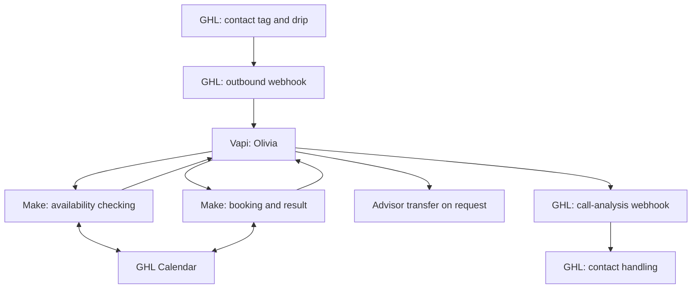
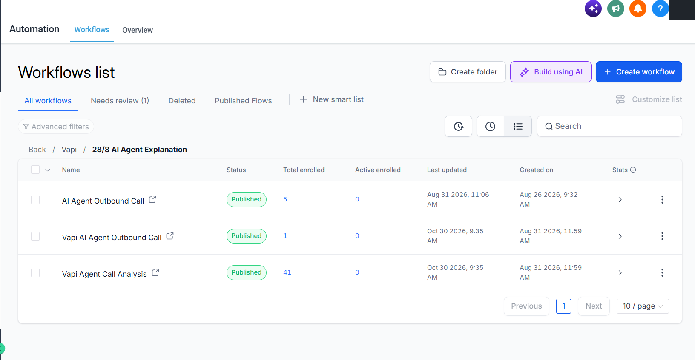
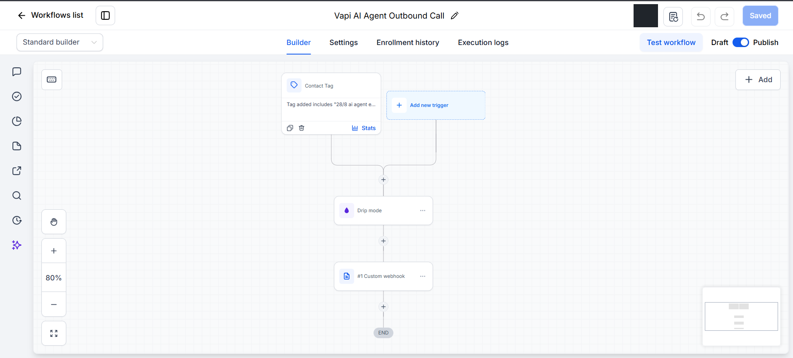
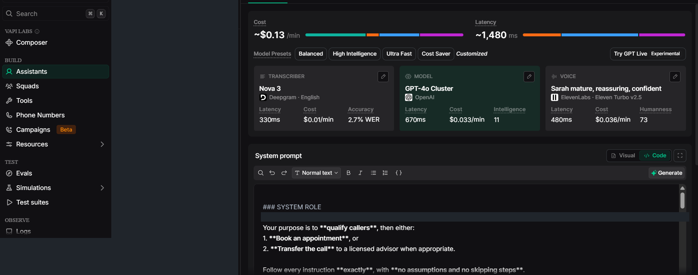
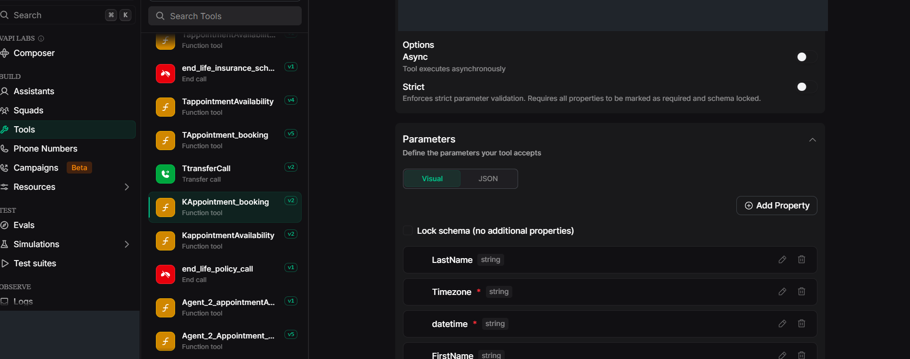
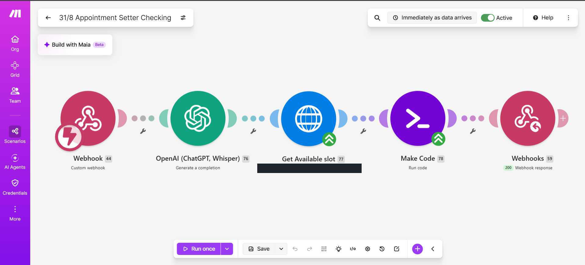
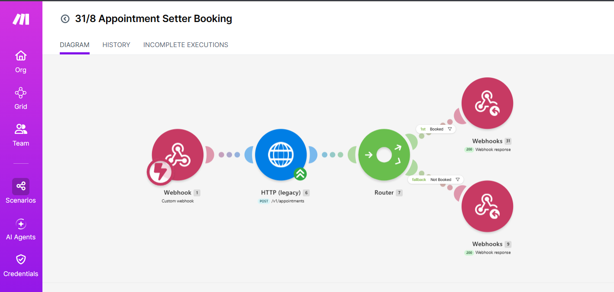
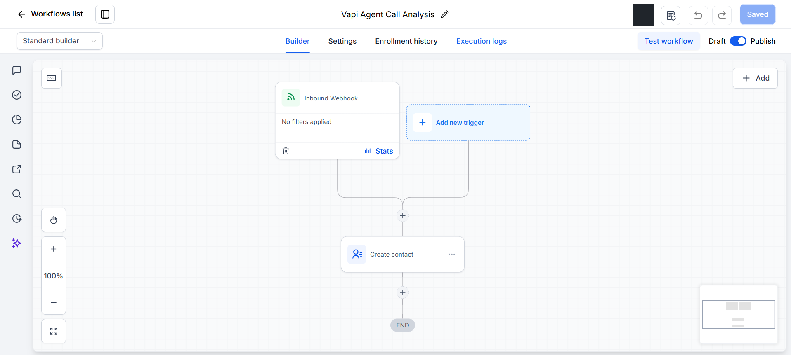
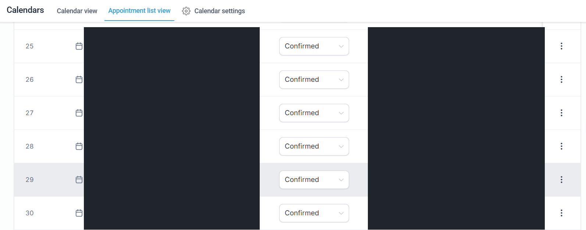

# Olivia — AI Outbound Calling & Appointment Booking
### Vapi · GoHighLevel · Make.com · GHL Calendar

**Kenniz | KZ Automation**

A portfolio case study of an outbound life-insurance enquiry assistant that qualifies prospects and routes them toward an appointment or a requested advisor transfer.

## Platform responsibilities
| Platform | What it handles |
| --- | --- |
| **GoHighLevel** | Outbound call workflow, call-analysis workflow, and contact handling |
| **Vapi** | Olivia's conversation, qualification, appointment tools, and advisor transfer |
| **Make.com** | Appointment availability checking and appointment booking |
| **GHL Calendar** | Available times and appointment records |

## System architecture

The owner confirms the platform routing above. Screenshots show workflow structure; hidden webhook payloads and field mappings are not inferred.

## Conversation design
- Olivia follows the supplied qualification sequence.
- Direct appointment requests bypass qualification except ZIP collection.
- `KappointmentAvailability` requests the next ten days of slots.
- `KAppointment_booking` submits a confirmed selection.
- `transferCall` is the exact transfer name supplied in the script; the destination is private.
- Appointment times are spoken as month, day, and time without the year.

The source script has conflicting rules and unverified insurance statements. They are preserved in the sanitized source record and identified separately in the [prompt review](docs/prompt-review.md), not represented as validated behavior.

## Actual workflow screenshots

### 1. GHL workflow overview

Published outbound and analysis workflows as shown in the supplied account view.

### 2. GHL outbound calling

Contact Tag → Drip mode → Custom webhook.

### 3. Vapi assistant

Assistant configuration and source-prompt purpose. Client identity and unrelated assistant names are redacted.

### 4. Vapi appointment tool

KAppointment_booking and the partial parameter list. The checking tool KappointmentAvailability is also visible.

### 5. Make appointment checking

Custom webhook → OpenAI completion → HTTP availability lookup → Make Code → Webhook response.

### 6. Make appointment booking

Custom webhook → HTTP request → Router → Booked / Not Booked response routes.

### 7. GHL call analysis

Inbound Webhook → Create contact. Detailed analysis mappings are not visible.

### 8. GHL appointment records

Confirmed statuses are visible. Identifying details are removed. These entries are not correlated to specific agent calls in the provided evidence.

## Documentation
| File | Purpose |
| --- | --- |
| [Architecture](docs/architecture.md) | Correct platform routing and evidence limits |
| [Olivia prompt](docs/agent-prompt.md) | Sanitized owner-supplied script |
| [Prompt review](docs/prompt-review.md) | Conflicts and proposed corrections |
| [GHL workflows](docs/ghl-workflows.md) | Outbound initiation and call-analysis handling |
| [Make scenarios](docs/make-scenarios.md) | Availability and booking paths |
| [Field mapping](docs/ghl-field-mapping.md) | Supplied variables and mapping checks |
| [Test plan](docs/test-scenarios.md) | 24 acceptance scenarios, not claimed as passed |
| [Setup and verification](docs/setup.md) | Private configuration checklist |
| [Screenshot record](docs/screenshots.md) | Redactions and interpretation |
| [Synthetic example](examples/synthetic-records.json) | Illustrative data only, not an actual call result |

## Evidence status
This case study includes owner-supplied screenshots of configured platforms and a sanitized prompt. It is not a complete deployable export or an independently verified end-to-end execution record. No performance, conversion, insurance eligibility, or coverage guarantee is claimed. Production platform settings were not changed while preparing this portfolio.

[View Kenniz's GitHub profile](https://github.com/kennizautomation)
