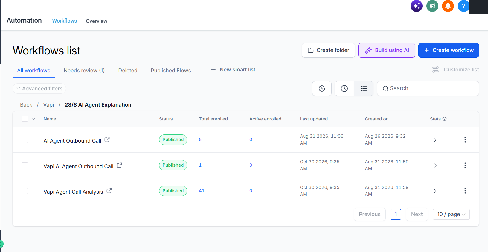
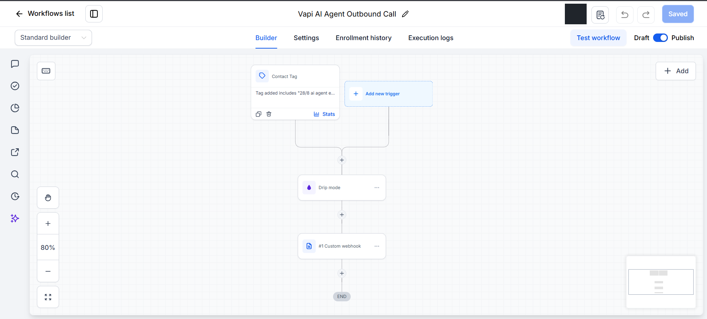
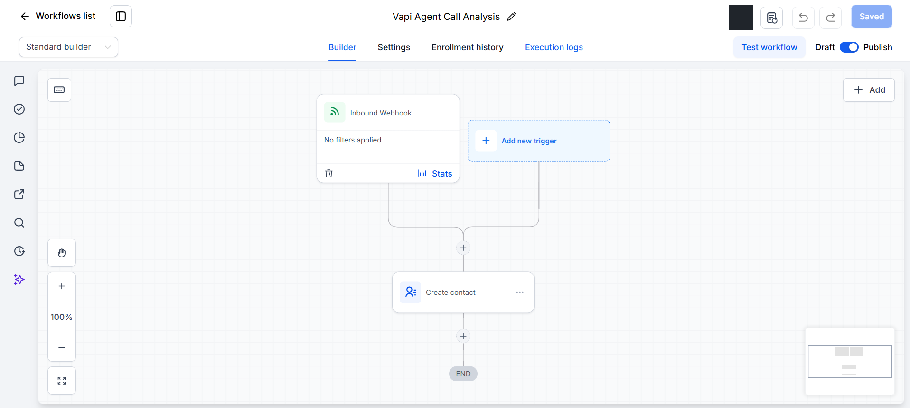
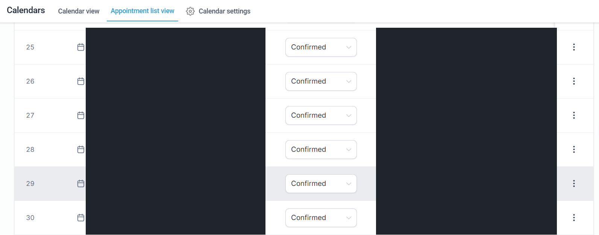

# GHL — outbound calling and call analysis

## Workflow inventory

The supplied inventory includes AI Agent Outbound Call, Vapi AI Agent Outbound Call, and Vapi Agent Call Analysis. Published states and enrollment counts are visible. Counts are workflow enrollments, not verified call volumes or conversions.

## Outbound call workflow

Visible sequence: **Contact Tag → Drip mode → Custom webhook**.
The owner identifies this as the workflow initiating outbound Vapi calls. Exact payloads, timing, endpoint, and connection credentials are not exposed.

## Call-analysis workflow

Visible sequence: **Inbound Webhook → Create contact**.
The owner confirms analysis handling is performed in GHL. This view does not prove particular extracted fields, summary content, opportunity updates, or duplicate handling.

## Calendar

Confirmed status labels are visible. Names, appointment titles, dates/times, and calendar identifiers/names have been concealed. These rows are not linked to a Vapi call ID or a Make execution in the provided evidence, so they are not presented as proof that every shown appointment came from this agent.

## Next checks
Inspect the outbound webhook mapping and analysis field mapping privately; verify correct contact matching and booking correlation using controlled test records.
