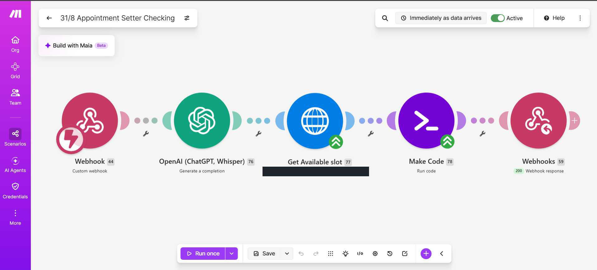
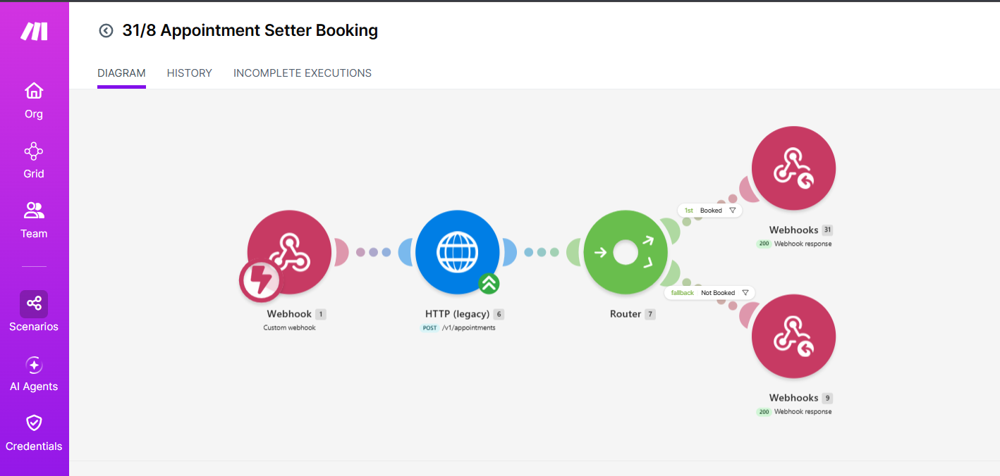

# Make.com — appointment checking and booking

Make handles appointment tools in this project. Outbound call initiation and call analysis belong to GHL.

## Scenario 1: appointment checking

Observed modules:
1. Custom webhook.
2. OpenAI — Generate a completion.
3. HTTP — Get Available slot.
4. Make Code — Run code.
5. Webhook response.

Agent function: `KappointmentAvailability`.
Prompt intent: retrieve the next ten days, match the requested time, and offer three closest alternatives when unavailable.

The calendar identifier is redacted. The OpenAI instructions, date calculations, HTTP configuration, code, and response schema are not supplied. Do not infer those details from module names.

## Scenario 2: appointment booking

Observed modules:
1. Custom webhook.
2. HTTP (legacy), labeled POST /v1/appointments.
3. Router.
4. “Booked” webhook response route.
5. “Not Booked” fallback webhook response route.

Agent function: `KAppointment_booking`.
Prompt intent: create the appointment after the caller confirms a returned slot.

This is an observed configuration, not an importable blueprint or a validated API recipe. Branch filters and full HTTP settings remain private/unverified.

## Validation tasks
- Confirm both attached Vapi tools reach the intended Make webhooks.
- Check required parameters and response format against the actual tool schema.
- Verify timezone conversion and the next-ten-days range.
- Test empty availability and fewer than three slots.
- Check that “Booked” requires actual appointment success.
- Reconcile timeouts before resubmission; avoid duplicate appointments.
- Distinguish HTTP acknowledgement from booking confirmation.

No Make outbound-dispatch, call-analysis, callback, or suppression scenario is asserted here.
